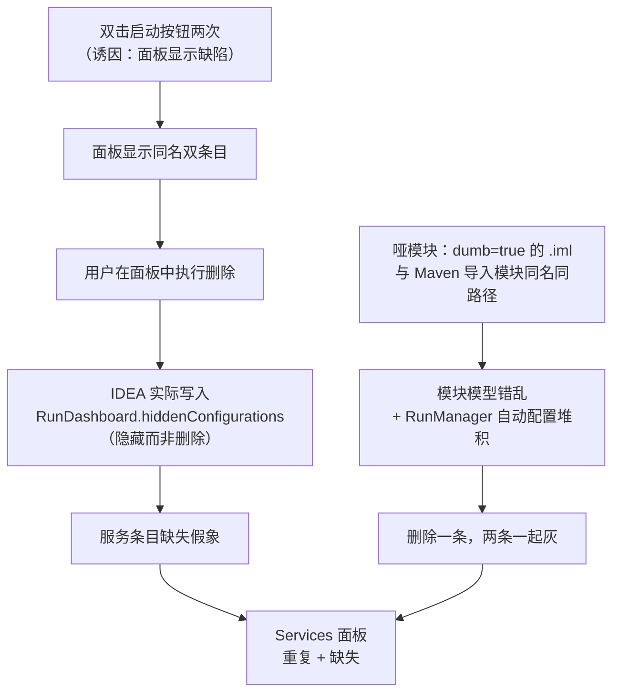
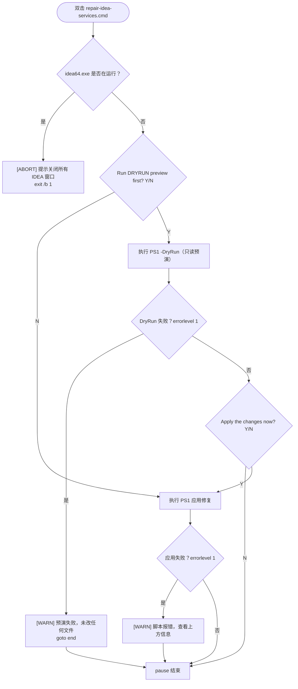
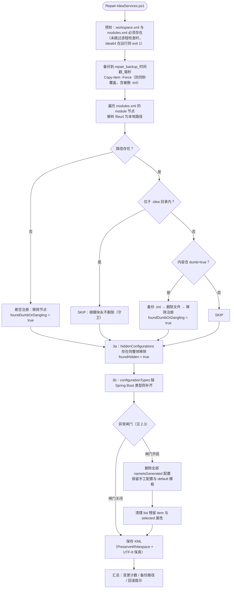
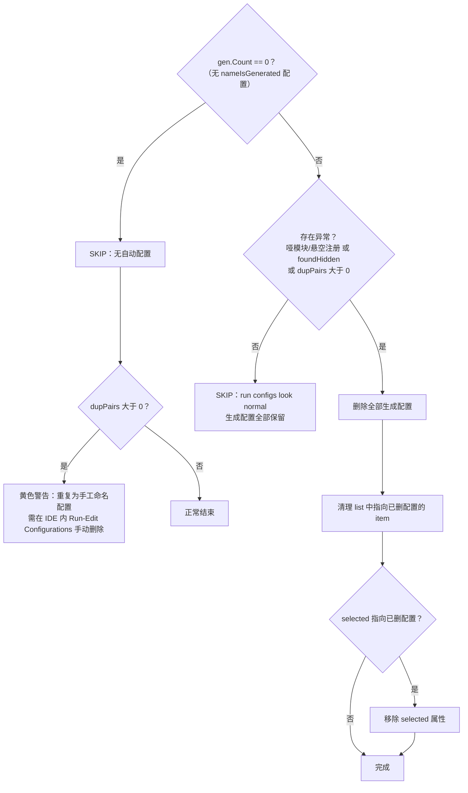
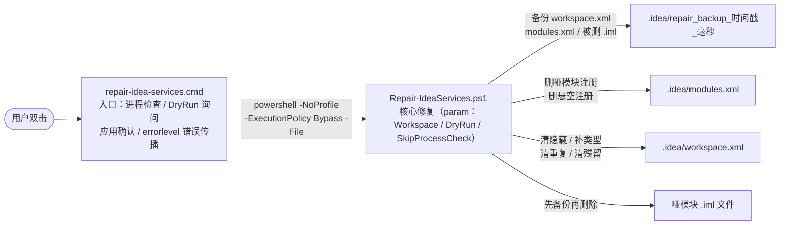

# IDEA Services 面板修复工具（repair-idea-services）

针对 `D:\Code\WorkSpace` 多 Maven 微服务工作区（30+ 模块）的 IntelliJ IDEA Services（Run Dashboard）面板 **"条目重复 + 条目缺失"** 问题的自动修复脚本。

| 文件 | 角色 |
|---|---|
| [repair-idea-services.cmd](./repair-idea-services.cmd) | 双击运行入口：IDEA 进程检查 → DryRun 预演询问 → 应用确认 → 错误传播 |
| [Repair-IdeaServices.ps1](./Repair-IdeaServices.ps1) | 核心修复逻辑：备份、哑模块清理、隐藏条目恢复、重复配置清理 |

---

## 1. 解决的问题

### 1.1 现象

- Services 面板同一服务出现**两条同名条目**；在面板里删除其中一条，**两条一起变灰失效**；
- 大量服务条目从面板中**消失**（缺失）；
- 诱因是启动服务时**双击了两次启动按钮**——它触发面板的一个显示缺陷（会话未收敛窗口期内同一配置显示两个节点），但把小问题放大成顽固现象的是下面三个配置层异常。

### 1.2 根因链



三个配置层异常的具体机制：

| 异常 | 位置 | 机制 | 后果 |
|---|---|---|---|
| 哑模块冲突 | `.idea/modules.xml` + 目录下 `dumb="true"` 的 `.iml` | 手动挂载的目录模块与 Maven 导入模块同名同路径，模块模型错乱 | 配置级重复的温床，模块解析错乱 |
| 隐藏而非删除 | `workspace.xml` → `RunDashboard.hiddenConfigurations` | 面板中对条目执行"删除"，IDEA 实际是记入隐藏清单 | 服务条目缺失假象 |
| 自动配置堆积 | `workspace.xml` → `RunManager` 中 `nameIsGenerated="true"` 的配置 | 每次运行主类都会持久化一条自动生成配置 | 重复条目的温床 |

### 1.3 修复范围与"不碰"清单

脚本做 6 件事：

| # | 修复项 | 目标文件 | 说明 |
|---|---|---|---|
| 1 | 删除哑模块及其注册 | `modules.xml` + `.iml` | `dumb="true"` 的 `.iml` **先备份进备份目录再删除**，并同步移除注册 |
| 2 | 清理悬空注册 | `modules.xml` | `fileurl` 指向不存在文件的注册节点直接移除 |
| 3 | 恢复被隐藏的条目 | `workspace.xml` | 整体移除 `RunDashboard.hiddenConfigurations`，被"删除"实为隐藏的服务重新显示 |
| 4 | 清理重复温床 | `workspace.xml` | 删除全部 `nameIsGenerated="true"` 的 Spring Boot 配置（**仅异常闸门开启时**，见 2.3），保留手工命名配置与 default 模板（`SHORTEN_COMMAND_LINE=MANIFEST` 兜底不受影响） |
| 5 | 清理残留引用 | `workspace.xml` | `RunManager` 下 `<list>` 中指向已删配置的 item、`selected` 属性（兼容 `Spring Boot.` 与 `SpringBootApplicationConfigurationType.` 两种前缀） |
| 6 | 补齐服务类型 | `workspace.xml` | `configurationTypes` 缺少 `SpringBootApplicationConfigurationType` 时补上 |

**不碰清单**：

- `external_build_system` 缓存（`%LOCALAPPDATA%\JetBrains\IntelliJIdea2025.3\projects\<hash>\external_build_system`，Maven 模块模型保持完好）；
- 手工命名的运行配置与 default 模板；
- `.idea` 内的根模块 `WorkSpace.iml`（守卫：永不删除，即使带 `dumb="true"`）；
- 其它一切 IDEA 数据。

---

## 2. 工作流程

### 2.1 双击入口流程（repair-idea-services.cmd）



关键点：IDEA 运行时**必须中止**——运行中的 IDEA 会用内存模型覆盖磁盘修改，修复等于白做。

### 2.2 核心修复流程（Repair-IdeaServices.ps1）



### 2.3 异常闸门判定（防止误删正常的自动配置）

自动生成配置在正常使用中会不断重建（每次运行主类都会持久化一条），**一律删除没有必要**。因此脚本只在确认存在异常时才清理：



重复判定键为 `配置名 + 子元素 module 的 name`（`module` 是子元素而非属性，早期版本误用 `GetAttribute('module')` 恒取到空串，已修复）。

---

## 3. 脚本核心代码架构

### 3.1 组件关系



### 3.2 Repair-IdeaServices.ps1 分节职责

| 分节 | 职责 | 关键实现 |
|---|---|---|
| §0 preflight | IDEA 进程检查 + 两个 XML 存在性检查 | `Get-Process idea64` / `Test-Path -LiteralPath`；`-SkipProcessCheck` 供测试用 |
| §1 backup | 修改前全量备份 | 毫秒时间戳目录 `repair_backup_yyyyMMdd_HHmmss_fff` + `Copy-Item -Force`（防同一秒二次运行覆盖原始备份）；DryRun 不建目录 |
| §2 modules.xml | 哑模块与悬空注册清理 | XPath `//module`；路径解析（`$PROJECT_DIR$` 替换 → `file://` 剥离 → URL 解码 → 反斜杠归一）；`.idea` 内守卫 `StartsWith($ideaDir, OrdinalIgnoreCase)`；`dumb="true"` 正则检测 |
| §3a hiddenConfigurations | 恢复被隐藏条目 | 定位 `RunDashboard/option[@name='hiddenConfigurations']`，整体 `RemoveChild` |
| §3b configurationTypes | 补齐 Spring Boot 服务类型 | `configurationTypes/set` 下缺 `SpringBootApplicationConfigurationType` 时 `AppendChild` |
| §3c 生成配置 | 异常闸门 + 重复清理 | `nameIsGenerated="true"` 选择集；重复键 `name + 子元素 module`；删配置后清理 `<list>` item 与 `selected` 属性 |
| §4 summary | 汇总输出 | DryRun 输出计划变更数；真实运行输出备份路径与回滚方法 |

### 3.3 关键设计决策

| 决策 | 理由 |
|---|---|
| 修改前必须关闭 IDEA | 运行中的 IDEA 会用内存模型把磁盘修改覆盖回去（CMD 与 PS1 双重检查） |
| 备份先行、`.iml` 也备份 | XML 可回滚；哑模块 `.iml` 的删除本不可逆，备份后同样可恢复 |
| 根模块守卫 | `.idea` 内唯一的合法 `.iml` 是项目根模块，误删会破坏整个项目 |
| 异常闸门 | 正常状态下自动配置应保留（删了也会随运行重建，没有必要）；只有确认异常才清理 |
| 幂等 | 所有操作先探测后执行，重复运行输出 `Nothing to repair`，无副作用 |
| XML 处理用 XmlDocument + `PreserveWhitespace` | 保留原缩进；按 XML 声明以 UTF-8 保存，中文内容保真（已断言验证） |
| 全 ASCII 输出 | 规避 Windows PowerShell 5.1 以 GBK 解析含中文字面量的 `.ps1` 导致的报错 |
| DryRun 默认推荐 | 预演零副作用（不建备份、不改文件），先看清将改什么再决定应用 |
| 不碰 external_build_system | Maven 模块模型存于外部缓存且完好，动它反而有风险 |

---

## 4. 使用方法

### 4.1 双击运行（推荐）

1. **关闭所有 IDEA 窗口**（脚本会自动检查，未关闭则中止）；
2. 双击 `repair-idea-services.cmd`；
3. 第一个询问选 **Y**（DryRun 预演，查看将改什么）；
4. 预演无异常后，第二个询问选 **Y** 应用；
5. 记下输出中的备份路径。

### 4.2 命令行运行

```powershell
# 只读预演
powershell -NoProfile -ExecutionPolicy Bypass -File "D:\Code\WorkSpace\.qoder\repair-idea-services\Repair-IdeaServices.ps1" -Workspace "D:\Code\WorkSpace" -DryRun

# 应用修复
powershell -NoProfile -ExecutionPolicy Bypass -File "D:\Code\WorkSpace\.qoder\repair-idea-services\Repair-IdeaServices.ps1" -Workspace "D:\Code\WorkSpace"
```

### 4.3 回滚

把备份目录（`.idea\repair_backup_<时间戳_毫秒>\`）里的文件复制回原位置即可：`workspace.xml`、`modules.xml` 回 `.idea\`；被删的 `.iml` 回其原目录。

### 4.4 修复后标准动作

重开 IDEA → 等待 Maven 导入完成 → Services 面板确认每个服务唯一。自动配置会随首次运行重建（`SHORTEN_COMMAND_LINE=MANIFEST` 已在 default 模板兜底）。

---

## 5. 验证情况

### 5.1 回归测试（27 项断言，全部通过）

在临时目录构造两个 fixture 端到端验证：

- **异常场景**：根模块带 `dumb="true"`（验证守卫）、哑服务模块（验证备份+删除+注册清理）、悬空注册、hiddenConfigurations、同名同模块双配置、`<list>`/`selected` 残留、UTF-8 中文内容保真、DryRun 零副作用、二次运行幂等；
- **正常场景**：无异常时生成配置原样保留、`selected` 保留、二次运行零变更。

### 5.2 真实工作区 DryRun

`0 change(s) planned`，全部 SKIP，守卫正确识别根模块（`root project module kept (inside .idea)`）。

---

## 6. 已知边界与注意事项

1. **会话级重复不在脚本能力范围**：双击两次产生的是同一配置的两个运行会话，配置本身只有一份（XML 无重复），脚本无法干预——正确做法是关掉多余会话。脚本只修**配置级 / 模块级**异常。
2. **workspace 路径硬编码**为 `D:\Code\WorkSpace`（CMD 内两处、PS1 默认值一处），工作区换目录需同步修改。
3. **面板中"删除"条目的习惯要改**：那是隐藏。恢复显示靠本脚本（或 IDEA 的 Services 面板还原）；根源上避免在 Project Structure 里手动挂载 Maven 子仓库目录（那是哑模块的来源）。
4. 脚本每次真实运行都会新建一个备份目录，**不会自动清理**，可定期手动删除旧的 `repair_backup_*`。
